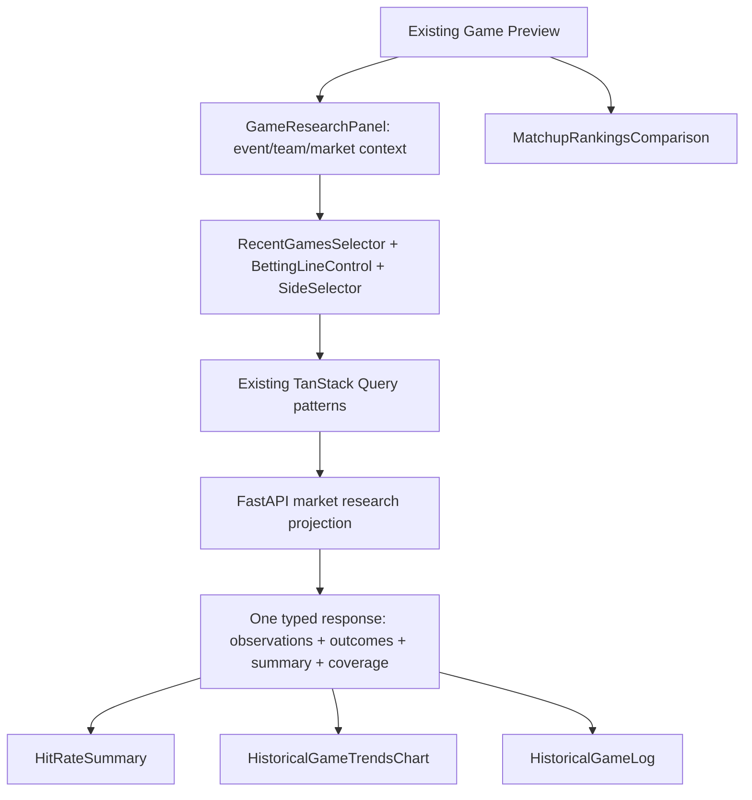

# Task 025 — reusable game-research component proposal

Task 026's [actual backend contract](../game-total-research-api.md) now supersedes
the proposed API seam below: all six windows and historical reference totals are
included. React chart/control proposals remain unimplemented and require Task 027
approval; no library was installed by the backend task.

All names/interfaces here are **proposals**, not files or endpoints already implemented. The [gap analysis](task-025-frontend-gap-analysis.md) identifies actual reuse. Behavioral references: [Game Total](nfl/game-total.md), [Team Total](nfl/team-total.md), [Moneyline/Spread](nfl/moneyline-spread.md), [shared research patterns](nfl/reusable-components.md), [independent contracts](nfl/implementation-reference.md), and [navigation/mobile observations](nfl/navigation.md).

## Composition without redesign

Start with an additive Game Research section on `/games/:gameId`, retaining summary/markets, rankings, Task 024 trends, logs, source details and schedule return navigation. Initially only Game Total is available; Team Total and Moneyline/Spread join after their backend slices. A future standalone team-market page can host the same components once deep-link/navigation behavior merits a separate task. Do not create seven empty tabs or redesign the app shell.

The server owns eligible IDs, derived metrics, exact threshold outcomes, summary mean and hit counts. React formats values, keeps controls and draws supplied results; it may reverse a copy of the observation array for chart/log ordering, but never filters a second eligibility sample or recomputes rates. Backend market adapters supply a metric descriptor and outcome labels, avoiding three independent chart implementations.

## Proposed reusable components

| Component | Inputs and responsibilities | Existing reuse / first consumers | Acceptance and boundaries |
|---|---|---|---|
| `HistoricalGameTrendsChart` | Canonical observation IDs, timestamp/opponent, metric/unit, nullable value, server outcome, Decimal-string threshold, direction/baseline, selected side; original bar chart and threshold marker | New renderer; Game Total → Team Total → Spread margin → later player stats | One response sample, chronological ascending, null gaps/text, actual zero values, signed margin axis crossing zero, pushes distinguished, keyboard/table equivalent and theme tokens. Tooltips show existing data only. Totals bars use an honest baseline; do not copy target's truncated axis without disclosure |
| `RecentGamesSelector` | Controlled window value, supported options, requested count and actual sample/count; accessible named select/buttons | Extract Task 024 local window control when reused; existing native select/style patterns | First L3/L5/L10, L5 default. L20/H2H/SEASON appear only after backend support; no hidden fallback. Each team retains its own sample; one shared window can update both independent requests. Preserve existing Task 024 reset behavior |
| `BettingLineControl` | Decimal-string draft/committed value, valid range/step for metric, optional explicitly labeled reference seed, reset and commit callback | New manual input/stepper; Game Total then Team Total/Spread | Accessible manual entry, ± controls, validation, 0.5 step proposed, no arbitrary clamp or fabricated line. Initial manual threshold unset unless user supplies it; a reference seed must be labeled unverified and never overwrite source history. Slider optional later for spread |
| `HitRateSummary` | Server counts, requested/selected/known-value/unknown counts, average/unit, side, threshold, numerator/denominator and denominator policy ID | New display; sample labels from Task 024 | Display raw Over/Under/Push or Cover/Push/Fail counts and unknowns. Use explicit rate label/formula; no frontend complement arithmetic, profit/ROI, predictive probability or bookmaker settlement implication |
| `HistoricalGameLog` | Same observations as chart, per-game scores/margin/points/outcome, independent optional historical-reference line/result/provenance, selected-event links | Extract safe cells/date/opponent/null/finality/source formatting from current preview/team logs without replacing them | Newest-first; chart/log selected IDs and known-value count match. Column headings distinguish “At selected threshold” and “At unverified source reference.” Missing reference does not drop a scored game. Native semantic table and focusable scroll region initially sufficient |
| `MatchupRankingsComparison` | Team pair, explicit comparison season/stage, metric descriptors, rank direction/unit/population/sample, authoritative ranks and values | Extract `MatchupComparison` presentation for Preview and market panel; retain existing Query cache | Four current categories first; points after approved backend ranking contract. Independent OFF vs DEF / DEF vs OFF switch affects panel only; season override never changes market history silently. No client ranks or fabricated advanced rows |
| `GameResearchContextSelector` / `MarketSelector` | Canonical event/team IDs and only supported market options; clear selected team indicator | Existing schedule game links, Router and API clients | Game Total uses selected team's historical **game** list; Team Total uses selected team's points. Team flip changes subject/threshold context without losing anchor game. Unsupported period/market options absent, not misleadingly interactive |
| `ResearchAvailability` | Loading/error/stale/empty/unknown chronology/partial flags, retry action and source messages | Reuse `Loading`, `Empty`, `ResearchFailure` and Task 024 team status patterns | One team/source/panel failure never blocks others; no cached L5 under L10 heading, no latest-data fallback for unknown historical cutoff. No new generic component framework until repeated markup warrants extraction |

## State and request boundary

Proposed shareable state: canonical game route plus subject team, market, window, side and committed manual line in allowlisted query parameters. Temporary input draft and disclosures stay local. Existing `returnTo` and `comparison_stage` must survive parameter updates. Do not persist hypothetical research as a sportsbook offer, or introduce saved picks. Rank-panel season is separate from game-history season. A new match resets an invalid team selection to a real participant; clear/relabel any old manual line rather than silently assigning it to the other team/market.

Query keys include team, matchup, season, stage, market, period, window, H2H opponent if supported, side and committed line. Forward AbortSignal, cancel superseded requests and validate response identity/context as `research.trends()` does. Debounce/commit typed line changes so requests remain bounded; keep last-good data only for the exact same identity/window/threshold with a clear stale warning. Selected-line chart marker and outcome table must change atomically from the same response; do not plot a draft line against old outcomes. A pending input may show its draft separately.

No extra API call is needed per metric or chart bar. Core history and optional reference/odds enrichment have separate availability flags; missing reference must not block manual research. Shared query caching may serve multiple components, but no new caching infrastructure is proposed. The backend reuses `accepted_query`/trend selection; HTTP-to-self calls, a second ingestion job, and client-side selection of raw season pages are unnecessary.

Game Total histories for both matchup teams can legitimately share an event. Each team's own sample is separate; a future merged sample must deduplicate canonical event IDs and declare its population. Never silently concatenate two team histories and call it a league/game sample.

## Proposed backend response seam

Prefer one adjacent market-research contract on the existing team-statistics router, for example `GET /api/teams/{team_id}/game-research` (route **proposed, not available**). Initially accept only `GAME_TOTAL`, L3/L5/L10, explicit season/REG or POST, required matchup UUID and optional manual Decimal threshold/side. Later adapters add `TEAM_TOTAL`, `SPREAD` and descriptive `MONEYLINE` results without duplicating history endpoints. Existing `/trends` remains backward compatible for six-metric comparisons; `/markets` remains the existing source-reference detail endpoint.

Proposed response responsibilities:

- Context: team/matchup IDs, season/stage, market/period, window, committed threshold and origin (`MANUAL`, or explicitly confirmed unverified-reference seed).
- Observations: one row per selected canonical game, actual team/opponent/side/date, reported scores/finality, derived value or null/reason, selected-threshold outcome and accepted pair/generation/source provenance.
- Summary: requested N, selected rows, known values, unknowns, mean, raw outcome counts, explicitly named rate denominator(s); empty samples => null averages/rates.
- Coverage: inherit trend cutoff/missing-date/statistics semantics; current revisions are not as-published snapshots; no completion-before-kickoff certification.
- Optional reference: null/unavailable reason initially; later attach validated original per-event reference fields separately from selected-line results. No team-total reference manufactured from game spread/total.

This is a service projection over existing data, not a new physical data model. Type/API naming and rate policy require approval in the next implementation scope.

## Dependency recommendation

The current package manifest includes React 19, Router 7, TanStack Query 5 and Tailwind 4; **neither Recharts nor TanStack Table is installed**. Existing dependencies suffice for selectors, summary cards, requests and native historical tables. A basic accessible SVG bar chart is possible with React alone, but responsive axes, signed domains, reference lines, tooltips and future repeated charts add maintenance work.

**P recommendation:** request a narrowly scoped Recharts dependency approval in the first chart UI task, not the backend task. It aligns with the established stack and centralizes chart behavior across three markets and eventual player research. Keep the renderer behind `HistoricalGameTrendsChart`; if approval is declined, implement a deliberately limited SVG chart/table fallback without adding another library or abandoning manual research.

Official checks on 2026-11-17: the [Recharts repository](https://github.com/recharts/recharts) documents composable React/SVG charts; its [MIT license](https://raw.githubusercontent.com/recharts/recharts/main/LICENSE) requires preserving the copyright/permission notice. The reviewed [upstream manifest](https://raw.githubusercontent.com/recharts/recharts/main/package.json) is a development/canary branch, **not a recommended version pin**. Verify a stable release's React/ReactDOM/react-is peer compatibility, license notices and actual bundle impact during the separately approved UI task; no version or size estimate is guaranteed here. No dependency was installed or approved by Task 025.

Do not add TanStack Table solely for 3–20 historical rows; native tables already satisfy current needs. No state-management library, new chart service, provider SDK, R runtime, queue or Redis is needed. No chart package determines eligibility or hit-rate definitions.

## Shared acceptance

All three markets use the same observation IDs in chart/log/summary, preserve null versus zero and mark pushes/ties/unknowns textually. Step/side/window/team changes cannot mix old and new contexts. Test keyboard input, light/dark tokens, 320/390px and desktop layouts, resize/tooltip behavior and table equivalence; no clipped line/period controls or floating overlay obscuring content. Test synthetic push/null/negative margin and correction cases independently; target screenshots guide behavior, not copied assets, colors, datasets or code.
